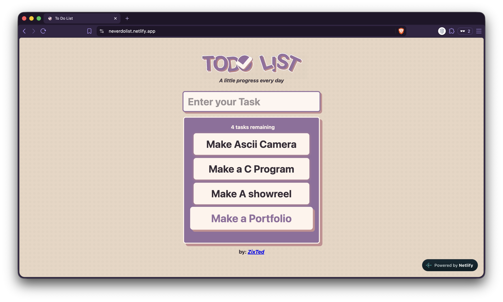

# To Do List

*A little progress every day.*

A small to-do app with an animated logo, built with plain HTML, CSS and JavaScript. No frameworks and no build step.

**Live demo:** https://neverdolist.netlify.app/




## Features

- Add a task by typing it and pressing **Enter** (blank tasks are ignored)
- Click a task to mark it done (strike-through), click again to undo
- Completed tasks show an **X** button that deletes them with a collapse animation
- Live counter of tasks remaining
- Layout adapts down to phone width
- Animated logo made in After Effects: an intro plays once, then hands off to a seamless loop

## Built with

- HTML and CSS (flexbox, transitions, `min()` for responsive widths)
- JavaScript (DOM manipulation, events, `classList`)
- After Effects for the logo animation, exported as WebM
- Netlify for hosting

## Run it locally

No install needed. Download or clone the repo and open `toDoList.html` in a browser, or use the VS Code **Live Server** extension.

```
neverdolist/
├── toDoList.html
├── toDoList.css
├── toDoList.js
├── bg.png
├── fadeIn.webm
└── logoLoop.webm
```

## What I learned

- Creating and removing elements with the DOM instead of hard-coding the list
- Handling nested clicks: the X button uses `event.stopPropagation()` so deleting a task doesn't also toggle it
- Keeping a JavaScript `setTimeout` in sync with a CSS transition so the delete animation finishes before the element is removed
- Making fixed-width layouts responsive
- Bringing a motion design piece from After Effects into a web page

## Next steps

- Save tasks with `localStorage` so they survive a refresh
- Limit task length so very long tasks don't get clipped
- Keyboard-friendly controls (complete and delete without a mouse)

## Author

Made by ZixTed.